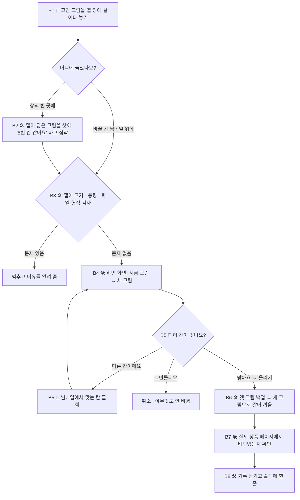

# 설계도: 상세페이지 일괄 교체기 (FTP 방식)

- 작성일: 2026-10-23. 마지막 수정: 2026-11-03
- 상태: 설계 정리 중. 아직 만들지 않음
- 방식: 카페24 그림 보관함(FTP)의 그림을 갈아 끼워서, 그 그림을 보는 링크 8개를 한꺼번에 바꿈 (2026-11-03 변경)
- 10/27의 화면 자동 조작 방식은 `wiki/카페24_상세페이지_교체도구_설계도_이전안_1027.md`에 그대로 남겨 둠. 카페24 API 조사 결과도 그 파일 9번에 있음
- 노션 "황현웅 AI 공방 자동화 설계도 업로드" 페이지의 FTP 방식 토글과 같은 내용

표기 규칙
- 「 」 안은 사용자의 말을 원문 그대로 옮긴 것
- (제안) = Claude가 제안한 것. 아직 확정되지 않음
- (확인 필요) = 실제 카페24 환경에서 확인해야 정해지는 것

## 한 줄 요약

고친 상세페이지 그림을 바탕화면 앱에 끌어다 놓으면, 카페24 **그림 보관함(FTP)**에 있는 같은 칸의 그림이 새 그림으로 바뀌고, 그 그림을 함께 보는 링크 8개(일반·비밀·히든)의 상세페이지가 **한꺼번에** 바뀌는 도구. 파일 이름은 고칠 필요 없다.

## 먼저 알아 둘 말

| 말 | 뜻 |
|---|---|
| **칸** | 상세페이지는 그림 여러 장이 위에서 아래로 쌓여 있다. 그 한 장 한 장의 자리. 위에서부터 1번 칸, 2번 칸… |
| **그림 보관함 (FTP)** | 카페24 안에 있는 그림 저장 폴더. 내 PC 폴더처럼 파일을 넣고 바꿀 수 있다 |
| **연결** | 상세페이지의 각 칸이 "보관함의 몇 번 그림을 보여 줘"라고 가리키게 해 두는 것. 제품마다 처음 한 번만 (A단계) |
| **갈아 끼우기** | 보관함의 그림을 같은 이름의 새 그림으로 바꾸는 것(덮어쓰기). 그 그림을 보는 링크 8개가 동시에 바뀐다 |
| **칸 메모** | "5번 칸 = 사이즈표"처럼 칸마다 무슨 그림인지 앱이 적어 두는 메모 |
| **백업** | 갈아 끼우기 전에 옛 그림을 따로 보관해 두는 것. 되돌릴 때 쓴다 |
| **반영 지연** | 그림을 바꿨는데 고객 화면에 잠깐 옛 그림이 보이는 현상 (캐시) |

## 무엇이 바뀌었나

원문 (11/3):
> 현재는 작업자가 작업을 완료하고 앱에 이미지를 끌어다 놓으면 클로드가 자동으로 카페24에 업로드하는 것으로 이해했는데, 이를 ftp 업로드 방식으로 변경하고 싶어. 카페24와 연결되 ftp와 같은 이 앱에 이미지를 업로드하면 상세페이지에 즉시 자동 반영되는 구조.

| | 이전 안 (10/27) | 지금 안 (11/3) |
|---|---|---|
| 무엇을 바꾸나 | 링크 8개의 상세설명을 하나씩 | 보관함의 그림 1장 |
| 어떻게 | 앱이 카페24 관리자 화면을 대신 클릭 | 보관함의 그림을 갈아 끼움 |
| 링크 8개 | 8번 열고 저장 | 1번 갈아 끼우면 8개가 동시에 |
| 바꿀 칸 찾기 | 링크마다 그림 비교 | 내가 칸 위에 놓거나, 앱이 닮은 칸을 짐작 → 내가 확인 |
| 내 파일 이름 | — | 고칠 필요 없음 |
| 카페24 팝업 · 화면 변경 걱정 | 있음 | 없음 (관리자 화면을 안 씀) |
| 칸 순서 바꾸기 | 상세설명을 고쳐서 | 칸끼리 그림을 맞바꿈 (C단계) |
| 그림 끼워 넣기 · 빼기 | 가능 | 아직 방법 미정 (D단계 · 12번) |

## 발표 순서 (약 3분)

1. **문제**: 제품 하나에 링크가 8개. 배너 1장이 바뀌면 상세설명 에디터 8개를 열어 그림을 눈으로 찾아 하나씩 올린다. 「거의 이틀에 한 건 꼴」, 한 건 10~15분
2. **핵심 아이디어**: 링크 8개가 각자 그림을 따로 갖지 말고, 보관함에 있는 **같은 그림 1장**을 함께 보게 한다. 그러면 그 1장만 갈아 끼우면 8개가 한꺼번에 바뀐다
3. **쓰는 법 (B단계)**: 고친 그림 끌어다 놓기(파일 이름 상관없음) → 확인 화면에 "지금 그림 ↔ 새 그림" → 맞으면 [올리기] → 앱이 실제 페이지에서 바뀌었는지 확인
4. **처음 한 번 할 일 (A단계)**: 제품마다 상세페이지를 보관함에 연결해 둔다. 연결된 제품부터 쓸 수 있다
5. **안전장치**: 갈아 끼우면 바로 고객에게 보이므로: 올리기 전 항상 확인 화면 · 옛 그림 백업 · 크기 · 용량 자동 검사 · 지우지 않음
6. **다음 단계**: 보관함 접속 정보 받기 · 바로 바뀌는지 시험 → 제품 1개 연결 → 도구 제작

## 작업물

| 무엇 | 상태 | 위치 |
|---|---|---|
| 설계도 개정 (FTP 방식, 12개 항목) | 완료 (11/3) | 이 파일 · 노션 |
| 보관함 접속 · 반영 속도 시험 (갈아 끼운 뒤 몇 초 만에 보이는지) | 할 일 | 12번 |
| 제품 1개를 보관함에 연결 (시범 · A단계) | 할 일 | 카페24 관리자 |
| 도구 본체 (바탕화면 앱, 끌어다 놓기) | 제작 예정 | PC마다 |

---

## 1. 이름

**상세페이지 일괄 교체기**. 원문 「제안한 대로 '상세페이지 일괄 교체기'로 한다.」 (10/27 확정) 그대로 둔다 (제안)

- 방식은 바뀌었지만 하는 일(한 번에 모든 링크의 그림을 바꿈)은 같음. "카페24에 올리기"처럼 동작 그대로의 이름도 후보 (제안)

## 2. 누가 쓰나

- 「회사 누구나 쓸 수 있는 도구로 만들 거야.」 「pc 수도 제한 없음으로 변경할게. 모든 구성원들이 쓸 수 있어야 하니까」
- 주로 쓰는 사람: 이미지를 만드는 디자이너가 완성하자마자 직접. 「작업자가 작업을 완료하고 앱에 이미지를 끌어다 놓으면」 → 운영팀에 파일을 넘기는 단계가 없어짐
- 운영팀 3명도 그대로 쓸 수 있음. 카페24 관리자 로그인이 필요 없어져서 부운영자 계정이 없는 사람도 쓸 수 있음 (제안)
- 단, 보관함 접속 계정은 하나를 같이 씀 → 누가 바꿨는지는 앱이 기록으로 남김 (제안)

## 3. 어떻게 시작하나

- **끌어다 놓기**. 바탕화면 앱 창에 이미지를 끌어다 놓는다. 버튼 · 문장 입력 · 시트 기입 없음
- 창 맨 위에서 브랜드 · 제품을 고르면 그 제품 상세페이지의 칸들이 썸네일로 위에서 아래로 나온다. 어느 칸을 바꿀지는 내가 칸 위에 놓거나 앱이 짐작한다(4번 B단계)
- **내 파일 이름은 고치지 않아도 된다**. 원문 「근데 저장할 때 이름을 일일이 별도 저장하는 것도 번거로워서 이 자동화를 떠올린건데. 파일명 별도 수정 과정이 없을 순 없을까?」 (11/3)
- "나스에 저장" 도구와 같은 창 모양을 쓴다. 나중에 한 번 끌어다 놓기로 나스 저장과 카페24 반영을 같이 하는 것도 가능 (제안)
- 앱 자체 로그인 없음 「로그인 필요 없음」. 보관함 접속 정보는 앱 설정에 숨겨 두고 사람은 보지 않음 (제안)

## 4. 안에서 어떤 순서로 만들어지나

단계 구분
- **A** = 처음 한 번: 제품을 보관함에 연결
- **B** = 평소: 그림 바꾸기
- **C** = 칸 순서 바꾸기
- **D** = 그림 끼워 넣기 · 빼기 (방법 미정)
- 뒤의 숫자는 순서. 예: B5 = 그림 바꾸기의 5번째 순서
- 🙋 = 사람이 하는 일 · 🛠 = 앱이 알아서 하는 일

### A단계 · 처음 한 번 · 제품을 보관함에 연결 (A1–A4)

지금 상세페이지 그림은 링크 8개가 각자 따로 올린 그림이다. 그래서 보관함에 새 그림을 넣어도 지금 페이지는 안 바뀐다. 처음 한 번, 링크 8개가 보관함의 그림을 보도록 연결해 둬야 한다.

| 순서 | 누가 | 하는 일 |
|---|---|---|
| A1 | 🛠 앱 | 나스에 있는 그 제품의 최신 상세페이지 그림을 보관함에 넣는다. 파일 이름은 칸 번호로 짓고(`01.jpg`, `02.jpg`…), "5번 칸 = 사이즈표" 같은 칸 메모를 적어 둔다 (제안) |
| A2 | 🛠 앱 | 상세설명에 붙여 넣을 글(HTML)을 만들어 준다. 내용은 "1번 칸은 보관함의 01.jpg를 보여 줘, 2번 칸은 02.jpg…" (제안) |
| A3 | 🙋 사람 | 카페24 관리자에서 링크 8개의 상세설명에 그 글을 붙여 넣고 저장. 일반 · 비밀 링크의 그림 구성이 다르면 글이 2개 |
| A4 | 🙋 사람 | 실제 상품 페이지를 열어 그림이 다 나오는지 확인 |

### B단계 · 평소 · 그림 바꾸기 (B1–B8)

예: 킴므 코르셋 사이즈표의 가격 문구를 고쳤을 때



| 순서 | 누가 | 하는 일 |
|---|---|---|
| B1 | 🙋 사람 | 고친 그림을 앱 창에 끌어다 놓는다. 파일 이름은 아무거나 괜찮다(`제목 없음-1.jpg`도 됨). 창에는 그 제품의 칸들이 썸네일로 쭉 나와 있다. **바꿀 칸을 알면** 그 칸 썸네일 위에 놓고(B2 건너뜀), **모르거나 여러 장이면** 창의 빈 곳에 놓는다 (제안) |
| B2 | 🛠 앱 | (빈 곳에 놓았을 때만) 새 그림과 가장 닮은 칸을 찾아 "5번 칸(사이즈표) 같아요" 하고 짐작한다. 문구만 고친 그림은 원래 그림과 거의 똑같이 생겨서 잘 맞는다. 따로 화면이 뜨지 않고 몇 초 만에 끝난다. AI 판단이 아니라 그림끼리 닮은 정도를 계산 (제안) |
| B3 | 🛠 앱 | 올려도 되는 그림인지 검사: 가로 폭이 원래 그림과 같은지, 용량이 너무 크지 않은지, jpg · png · gif인지. 문제가 있으면 멈추고 이유를 보여 준다. 닮은 칸을 못 찾았으면 짐작 없이 B5에서 사람이 고른다 |
| B4 | 🛠 앱 | **확인 화면**을 띄운다. 바뀔 칸의 지금 그림(왼쪽)과 새 그림(오른쪽)을 나란히 보여 주고 "5번 칸(사이즈표)을 이 그림으로 바꿉니다. 링크 8개에 바로 보입니다"라고 알려 준다. 여러 장이면 장마다 한 줄씩 목록으로 (아래 화면 예시) |
| B5 | 🙋 사람 | 확인 화면에서 버튼 하나를 누른다. **[올리기]** 칸이 맞을 때 · **[다른 칸 고르기]** 칸이 틀렸을 때 → 썸네일에서 맞는 칸을 누르면 확인 화면이 다시 뜬다 · **[취소]** 그만둘 때 |
| B6 | 🛠 앱 | 옛 그림을 백업해 두고, 새 그림의 이름을 그 칸의 파일 이름(`05.jpg`)으로 바꿔 보관함에 갈아 끼운다. 사람은 이름을 만지지 않는다 |
| B7 | 🛠 앱 | 실제 상품 페이지의 그림이 새 그림으로 바뀌었는지 확인한다. 아직 옛 그림이면 "반영 대기"로 표시 (반영 지연 → 12번) |
| B8 | 🛠 앱 | 누가 · 언제 · 어느 칸을 바꿨는지 기록하고 슬랙에 한 줄 |

B4 확인 화면 예시

```txt
┌──────────────────────────────────────────────┐
│ kymm 킴므 코르셋 · 5번 칸 (사이즈표)
│
│    [지금 그림]          →          [새 그림]
│   지금 고객이 보는 것             방금 놓은 것
│
│  ⚠ 올리면 링크 8개에 바로 보입니다
│
│  [ 올리기 ]   [ 다른 칸 고르기 ]   [ 취소 ]
└──────────────────────────────────────────────┘

여러 장을 한꺼번에 놓으면 한 줄씩:
  5번 칸 사이즈표   [지금] → [새]   ✔
  7번 칸 성분표     [지금] → [새]   ✔
```

이럴 땐 이렇게. 앱은 짐작만 하고 바로 올리지 않는다. 항상 확인 화면을 거친다 (제안)

| 이럴 때 | 사람이 하는 일 |
|---|---|
| 한 장, 바꿀 칸을 알 때 | 그 칸 썸네일 위에 놓기 → [올리기] |
| 문구 · 가격 · 오타만 고쳤을 때 (대부분) | 빈 곳에 놓기 → 앱이 짐작한 칸 확인 → [올리기] |
| 디자인을 크게 바꿔 앱이 못 찾을 때 | 빈 곳에 놓기 → [다른 칸 고르기]로 칸 클릭 → [올리기] |
| 여러 장을 한꺼번에 | 빈 곳에 다 놓기 → 장마다 짝지은 목록 확인 → [올리기] |
| 파일 이름이 이미 `05_사이즈표`처럼 되어 있을 때 | 앱이 이름을 보고 바로 칸을 찾음 → [올리기] |

보조 방법 (안 해도 됨): 포토샵 대지(아트보드) 이름을 `05_사이즈표`처럼 **처음 한 번만** 지어 두면, "대지 내보내기"할 때마다 그 이름으로 파일이 나온다. 저장할 때마다 이름을 고칠 일은 없다 (제안)

B단계로 하는 일: 「배송 안내 배너 문안 수정」 「사이즈표와 성분표 2장을 동시에 교체」 같은 그림 바꾸기

### C단계 · 칸 순서 바꾸기 (C1–C5)

예: 3번 칸(리뷰)과 5번 칸(사이즈표)의 순서를 바꾸고 싶을 때. 칸의 위치는 그대로 두고 **두 칸의 그림을 서로 맞바꿔** 갈아 끼운다. 그래서 카페24 상세설명은 건드리지 않는다 (제안)

```txt
바꾸기 전:  3번 칸 [리뷰]       5번 칸 [사이즈표]
바꾼 뒤:    3번 칸 [사이즈표]   5번 칸 [리뷰]
```

| 순서 | 누가 | 하는 일 |
|---|---|---|
| C1 | 🙋 사람 | **[순서 바꾸기]**를 누르고, 칸 썸네일을 끌어서 원하는 순서로 놓는다 |
| C2 | 🛠 앱 | 확인 화면: 바꾸기 전과 바꾼 뒤의 전체 순서를 나란히 보여 주고, 바뀌는 칸을 표시한다("3번 리뷰 ↔ 5번 사이즈표"). "링크 8개에 바로 보입니다" |
| C3 | 🙋 사람 | **[올리기]** 또는 **[취소]** |
| C4 | 🛠 앱 | 바뀌는 칸의 옛 그림을 모두 백업한 뒤 새 순서대로 갈아 끼우고, 칸 메모도 고친다("3번 칸 = 사이즈표") |
| C5 | 🛠 앱 | 실제 상품 페이지에서 칸마다 확인 · 기록 · 슬랙 한 줄. 되돌릴 때는 한 번에 |

- 그림 장 수가 그대로일 때만 된다. 장 수가 늘거나 줄면 D단계
- 여러 장을 차례로 갈아 끼우는 몇 초 동안 순서가 섞여 보일 수 있다 → 12번 반영 지연 시험 때 같이 잰다 (확인 필요)

### D단계 · 그림 끼워 넣기 · 빼기 (방법 미정)

예: 「추석 이벤트 배너 1장을 맨 위에 끼워 넣음, 끝나고 다시 뺌」. 칸 수가 바뀌어서 그림 갈아 끼우기만으로는 안 되고 카페24 상세설명도 고쳐야 한다. 방법은 12번에서 정하고, 정해지면 D1, D2… 순서를 여기에 붙인다

## 5. 결과물

| 무엇 | 모양 | 어디로 | 한 번에 몇 개 |
|---|---|---|---|
| 상세페이지 그림 | 칸 번호 이름(`05.jpg`)으로 갈아 끼움. 칸 메모는 앱이 기억 | 카페24 그림 보관함(FTP) `/web/upload/detail/(브랜드)/(제품)/` (제안) | 1장 ~ 여러 장. 한 번에 한 제품 「한 제품만. 제품마다 상세페이지가 달라서 겹치는 이미지가 없다.」 |
| 바뀌는 곳 | 그 그림을 보는 모든 링크의 PC 상세페이지. 모바일 상세설명은 「따로 안씀」 | 카페24 실제 상품 페이지. 즉시 | 보통 8개 링크 |
| 옛 그림 백업 | 원래 이름 + 바꾼 시각 | 보관함 `/web/upload/detail/_backup/` 또는 나스 (제안) | 바뀐 장 수만큼 |
| 기록 | 누가 · 언제 · 제품 · 칸 · 확인 결과 한 줄 (엑셀로 열리는 CSV) | 나스 공유 폴더 | 작업당 1줄 |

## 6. 언제 도나

- **일할 때 옆에서**. 사람이 끌어다 놓고 올리기를 누를 때만 돈다
- 폴더에 저장만 하면 저절로 올라가는 방식(WinSCP 자동 동기화)은 쓰지 않음. 작업 중인 미완성 그림이 고객에게 바로 보일 수 있기 때문 (제안)
- 이벤트 배너의 예약 빼기는 범위 밖 「예약 빼기는 지금은 필요 없다. 끝나면 사람이 도구로 빼면 된다.」

## 7. 사람이 꼭 눈으로 보는 곳 · 누가 승인하나

- B4 · B5 확인 화면 (바뀔 칸의 지금 그림 ↔ 새 그림). 칸이 맞는지도 여기서 본다. 이전 안의 「미리보기 후 적용」 원칙 유지
- C2 순서 확인 화면 (바꾸기 전 ↔ 바꾼 뒤 전체 순서)
- A4 연결 직후 실제 상품 페이지 확인 (링크마다 그림이 다 나오는지)
- 승인: 끌어다 놓은 본인이 [올리기]. 별도 승인자 없음 (제안)
- 되돌리기: [되돌리기]를 누르면 백업해 둔 옛 그림을 다시 갈아 끼운다 (제안)

## 8. 절대 안 되는 것

모두 (제안)

- 확인 화면 없이 올리지 않는다. 갈아 끼우는 순간 고객에게 보이기 때문
- 옛 그림을 백업하지 못했으면 올리지 않는다
- 보관함의 그림을 지우지 않는다. 치울 때도 백업 폴더로 옮기기만
- 보관함의 상세페이지 폴더(`/web/upload/detail/`) 밖은 건드리지 않는다. 쇼핑몰 디자인 파일(html · css · js)은 절대 건드리지 않는다
- 앱이 짐작한 칸에 사람 확인 없이 올리지 않는다. 닮은 그림을 못 찾으면 짐작하지 않고 사람이 칸을 고르게 한다
- 가로 폭이 원래 그림과 다르거나 용량이 너무 크면 올리지 않는다
- 그림 자체는 손대지 않는다 (크기 조정 · 압축 없이 그대로)
- 한 번에 두 제품 이상 처리하지 않는다
- 순서 바꾸기는 장 수가 같을 때만. 바뀌는 칸을 하나라도 백업하지 못했으면 아무것도 갈아 끼우지 않는다
- 보관함 접속 정보(주소 · 아이디 · 비밀번호)는 앱 설정 · secrets 폴더에만. GitHub · 슬랙 · 노션 · 메신저에 적지 않는다

## 9. 필요한 도구 · 계정 · 비용

| 무엇 | 왜 | 준비 상태 |
|---|---|---|
| 바탕화면 앱 (PC마다, 수 제한 없음) | 본체. 끌어다 놓기 · 확인 화면 · 갈아 끼우기 | 제작 예정 |
| 카페24 그림 보관함(FTP) 접속 정보 (주소 · 아이디 · 비밀번호) | 그림 갈아 끼우기 | 대표운영자가 관리자에서 확인 · 발급 (확인 필요) |
| 카페24 관리자 (A단계 연결 때만) | 상세설명을 보관함에 연결 (제품마다 1회) | 운영팀 부운영자 계정 있음 |
| 나스 공유 폴더 | 기록 · 백업(선택) · 설정 파일 | 위치 지정 필요 |
| 슬랙 채널 + Incoming Webhook | 끝날 때마다 한 줄 알림 | 슬랙 관리자가 1회 생성 |
| 카페24 API · 카페24 앱 · 화면 자동 클릭 | 필요 없음 | — |

- 비용: 0원 (제안). FTP는 카페24 쇼핑몰에 기본으로 딸린 기능이라 따로 결제 없음 (확인 필요)
- 이전 안은 카페24가 관리자 화면을 바꾸면 도구가 멈췄다. 이번 안은 관리자 화면을 쓰지 않아 그 걱정이 없다. 대신 보관함 접속 정보를 잘 관리해야 한다
- 참고: WinSCP 같은 FTP 프로그램으로 손으로도 할 수 있다. 앱은 거기에 칸 찾기 · 검사 · 확인 화면 · 백업 · 기록을 더한 것 (제안)

## 10. 결과를 받는 곳 · 누구에게 알리나

- 결과는 실제 상품 페이지 자체. 앱의 완료 창에 링크 하나를 띄워 바로 열어 볼 수 있게 (제안)
- **기록 → 나스 공유 폴더** 「모아야 한다. 나스 공유 폴더에 기록 파일을 쓰게 하면 된다.」
- **알림 → 슬랙** 「끝날 때마다 슬랙 채널에 한 줄 올라오면 좋겠다.」

```txt
[상세페이지 일괄 교체기] 황현웅 · kymm 킴므 코르셋 · 그림 바꾸기 2장 (5번 사이즈표, 7번 성분표) · 페이지 반영 확인 · 기록: \\SynologyNas\…
[상세페이지 일괄 교체기] 황현웅 · kymm 킴므 코르셋 · 그림 바꾸기 1장 (1번 배송안내) · 반영 대기 · 기록: …
```

## 11. 잘 됐다는 걸 무엇으로 아나 (숫자로)

| 지표 | 지금 | 목표 (제안) |
|---|---|---|
| 한 건에 사람이 손대는 횟수 | 상세설명 편집 8번 | 끌어다 놓기 1번 + [올리기] 1번 |
| 파일 이름을 손으로 고치는 횟수 | 저장할 때마다 | 0번 |
| 앱의 칸 짐작이 한 번에 맞은 비율 | — | 90% 이상. 낮으면 포토샵 대지 이름 방법도 같이 씀 |
| 한 건당 걸리는 시간 | 10~15분 「한 건에 10~15분 정도」 | 1분 이내 |
| 빠뜨린 링크 | 알 수 없음 | 0개 (연결된 링크는 모두 같은 그림을 보므로 빠질 수 없음) |
| 보관함에 연결된 제품 수 | 0 | 상세페이지가 있는 제품 전부 |
| 올린 뒤 고객 화면에 보이기까지 걸린 시간 | — | 기록해 두고 반영 지연 대응을 정할 때 씀 |
| 되돌리기 쓴 횟수 | — | 월 1회 이하 |

- 빈도 「거의 이틀에 한 건 꼴」 → 한 달 약 15건. 한 건 1분이면 한 달 2.5~4시간 → 15분 안쪽 (제안)

## 12. 아직 모르는 것

### 실제로 해 봐야 아는 것

- **반영 지연**: 그림을 갈아 끼워도 카페24 서버나 고객 브라우저가 옛 그림을 잠깐 보여 줄 수 있다. 「즉시 자동 반영」이 되는지 시범 제품에서 재 보고, 늦으면 ① 몇 분 늦는 건 그냥 둔다 ② 바꿀 때마다 파일 이름에 번호를 붙이고 상세설명도 고친다(바로 보이지만 상세설명 수정이 다시 생김) 중 고른다 (확인 필요)
- **보관함 접속 정보 · 위치**: 우리 몰의 FTP 주소, 그림이 공개되는 실제 주소(`/web/upload/` 아래인지), 계정을 여러 개 만들 수 있는지 (확인 필요)
- **"닮았다"의 기준**: 얼마나 닮아야 앱이 "이 칸 같아요"라고 짐작할지(문구만 바뀐 그림 · 배경만 바뀐 그림). 시범 제품의 실제 수정 사례로 맞춘다 (확인 필요)

### 사람이 정할 것

- **D단계 · 끼워 넣기 · 빼기를 어떻게 할지**: 후보 (제안) ① 이것만 지금처럼 손으로(또는 이전 안의 화면 조작으로) ② A단계 때 맨 위에 빈 칸(투명 그림)을 하나 미리 만들어 두고, 이벤트 때 그 칸에 배너를 갈아 끼우고 끝나면 다시 투명 그림으로 ③ 상세설명 전체를 보관함의 파일 하나로 불러오게 바꿔서 끼워 넣기 · 빼기도 앱에서 (가장 자유롭지만 카페24에서 되는지 확인 필요)
- **일반 · 비밀 링크의 그림이 다를 때**: 「비밀링크와 일반링크는 다를 수 있다.」 → 보관함 폴더를 둘로 나눌지(`…/common` · `…/secret`) (제안)
- **A단계 연결을 누가 · 언제**: 제품마다 한 번씩. 연결 안 된 제품은 앱이 "연결 필요"로 표시 (제안)
- **나스 저장 도구와 합칠지**: 한 번 끌어다 놓기로 나스 저장 + 카페24 반영 (제안)
- **포토샵 대지 이름 방법을 같이 쓸지**: 앱 짐작만으로 충분하면 안 써도 된다. 시범 제품에서 짐작이 얼마나 맞는지 보고 정한다 (제안)
